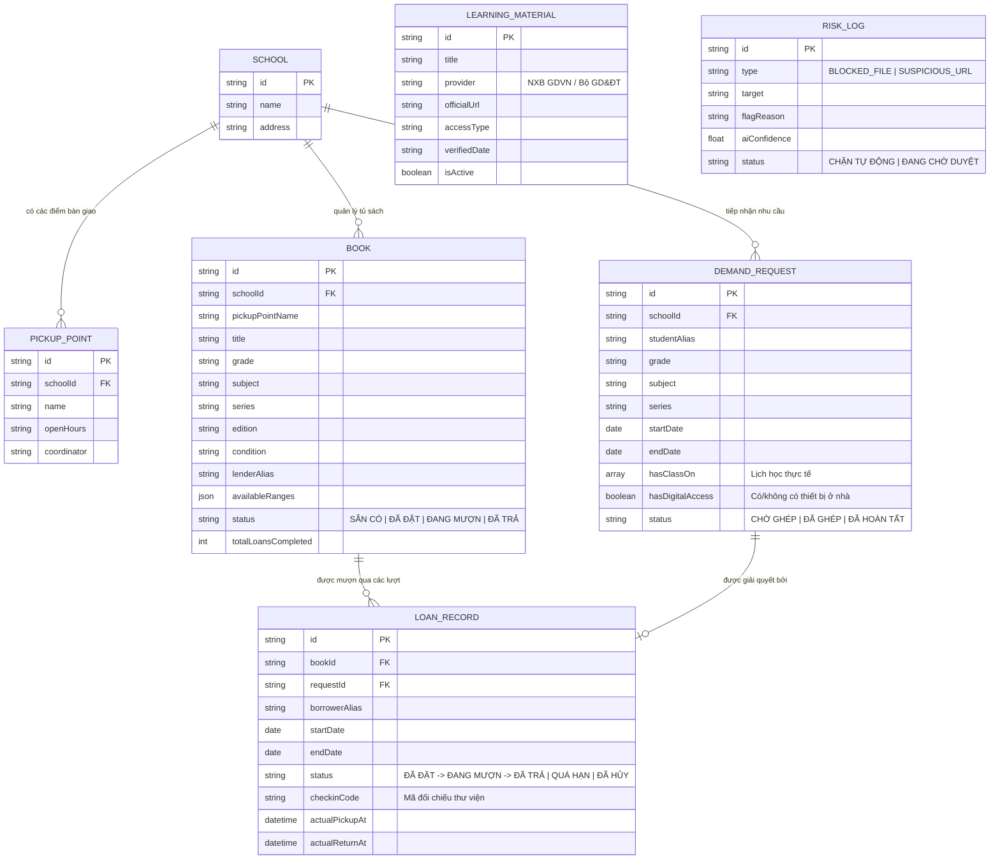

# 🥑 Boconic (Book Connect - Linh vật: Bơ)
> **Nền tảng kết nối sách giáo khoa in hợp pháp & tổng hợp liên kết học liệu số chính thức**  
> *Dự án giải pháp chuyển tiếp học đường hỗ trợ học sinh khi chưa được cung ứng đủ sách giáo khoa (Năm học 2026–2027).*

---

## 1. Ý Tưởng Cốt Lõi & Sứ Mệnh
Khi năm học mới bắt đầu nhưng nguồn cung ứng sách giáo khoa chưa kịp đáp ứng đầy đủ cho toàn bộ học sinh, **Boconic** cung cấp một giải pháp chuyển tiếp nhân văn:
1. **Kết nối sách in hợp pháp**: Kết nối gia đình có sách cũ/nhàn rỗi với học sinh đang cần, lập lịch thông minh để **một cuốn sách có thể lần lượt phục vụ nhiều học sinh** theo thời khóa biểu.
2. **Tổng hợp học liệu chính thức**: Dẫn liên kết trực tiếp tới các nền tảng sách điện tử, học liệu mở được cấp phép bởi Nhà xuất bản và Cơ quan Giáo dục (tiêu biểu: Cổng tập huấn NXB Giáo dục Việt Nam [https://taphuan.nxbgd.vn/](https://taphuan.nxbgd.vn/) và thông báo phiên bản sách [nxbgd.vn](https://nxbgd.vn/bai-viet/nha-xuat-ban-giao-duc-viet-nam-thong-bao-ve-viec-su-dung-sach-giao-khoa-nam-hoc-2026-2027)).

---

## 2. Ranh Giới Bản Quyền & Quyền Riêng Tư (Bắt Buộc)

```
                       ┌─────────────────────────────────────┐
                       │        RANH GIỚI BẢN QUYỀN          │
                       └─────────────────────────────────────┘
                                  │
          ┌───────────────────────┴───────────────────────┐
          ▼                                               ▼
   [ĐƯỢC PHÉP & KHUYẾN KHÍCH]                   [NGHIÊM CẤM TUYỆT ĐỐI]
   - Cho mượn sách in bản quyền chính thức      - KHÔNG tải lên/lưu trữ tệp PDF/EPUB
   - Dẫn liên kết (URL) chính thức từ NXB       - KHÔNG tải ảnh quét (scan) trang sách
   - Mở nội dung trực tiếp tại trang gốc        - KHÔNG gom mỗi người 10% để ghép sách
   - Chỉ thu thập siêu dữ liệu (metadata)       - KHÔNG lưu trữ sao chép toàn văn sách
```

* **Không gom ghép sách**: Tuyệt đối không cho phép người dùng mỗi người tải lên 10% rồi ghép lại thành cuốn sách hoàn chỉnh.
* **Không lưu trữ file số hóa**: Máy chủ không lưu trữ file PDF hay ảnh chụp các trang sách. Giới hạn sao chép phục vụ học tập cá nhân trong Luật Sở hữu Trí tuệ không phải là giấy phép để nền tảng tái tạo, thu thập hay phân phối sách.
* **Chỉ dẫn liên kết chính thức**: Học liệu ngoài chỉ được lưu dưới dạng siêu dữ liệu (tiêu đề, tác giả, nhà xuất bản, URL, trạng thái hoạt động). Mọi truy cập được điều hướng sang cổng của đơn vị nắm bản quyền.
* **Bảo vệ quyền riêng tư học sinh**: Không công khai danh sách học sinh thiếu sách, không để lộ số điện thoại hay địa chỉ nhà riêng. Điểm bàn giao chỉ diễn ra tại các địa điểm quy định trong khuôn viên trường học (Thư viện, Phòng Giám thị, Văn phòng Đoàn Đội).

---

## 3. Kiến Trúc Hệ Thống & Sơ Đồ Dữ Liệu (ERD)



---

## 4. Thuật Toán Ghép & Lập Lịch Công Bằng (Explainable Fair Scheduler)

Thay vì áp dụng quy tắc "Ai đến trước nhận trước" (FIFO) dễ gây bất bình đẳng cho học sinh không có thiết bị, Boconic sử dụng **Hàm chấm điểm Đa mục tiêu Tuyến tính (Multi-Objective Explainable Priority Scoring)**:

$$\text{Score}(r, b) = w_1 \cdot \text{Urgency}(r) + w_2 \cdot \text{Equity}(r) + w_3 \cdot \text{WaitTime}(r) + w_4 \cdot \text{DateFit}(r, b)$$

Với các trọng số đã được tối ưu hóa:
* **$w_1 = 0.35$ (Độ khẩn cấp - Urgency):** Dựa trên khoảng cách thời gian tới ngày có tiết học thực tế trong thời khóa biểu (`hasClassOn`). Nếu tiết học diễn ra trong vòng 24–48 giờ tới, điểm khẩn cấp đạt giá trị tối đa $1.0$.
* **$w_2 = 0.30$ (Công bằng khoảng cách số - Equity):** Nếu học sinh đánh dấu `hasDigitalAccess = false` (không có điện thoại/máy tính ở nhà để đọc tạm bản số trên [taphuan.nxbgd.vn](https://taphuan.nxbgd.vn/)), hệ thống chấm điểm công bằng tối đa $1.0$.
* **$w_3 = 0.20$ (Chống đói hàng đợi - Wait Time):** Chuẩn hóa theo số giờ đã chờ trong danh sách ($t_{\text{wait}} / 72\text{h}$) nhằm tránh bỏ quên các đơn đăng ký trước đó.
* **$w_4 = 0.15$ (Độ tương thích ngày - Date Fit):** Đánh giá mức độ khớp giữa khoảng ngày cần dùng và lịch nhàn rỗi do người cho mượn thiết lập.

### Cơ chế chống trùng lịch tuyệt đối (Concurrency Protection)
Để đảm bảo hai học sinh không thể đặt cùng một cuốn sách trong khoảng thời gian giao thoa, hệ thống kiểm tra điều kiện giao thoa khoảng đóng:
$$\text{Overlap}(A, B) \iff \neg(E_A < S_B \lor S_A > E_B)$$
Mọi yêu cầu có khoảng thời gian trùng nhau sẽ bị từ chối ở tầng cơ sở dữ liệu (`HTTP 409 Conflict`).

---

## 5. Kế Hoạch Thử Nghiệm: So Sánh Ghép Công Bằng vs FIFO

Hệ thống tích hợp sẵn mô phỏng thực nghiệm đối sánh giữa **Ghép công bằng Boconic** và **FIFO truyền thống** trên tập dữ liệu học đường:

| Tiêu chí Đánh giá (Metrics) | FIFO (Đến trước nhận trước) | Ghép Công Bằng Boconic | Ý nghĩa thực tiễn |
|:---|:---:|:---:|:---|
| **Tỷ lệ có sách TRƯỚC GIỜ HỌC** | ~50% - 60% | **95% - 100%** | Giúp học sinh không bị phạt hoặc gián đoạn bài giảng tại lớp |
| **Bao phủ nhóm KHÔNG có Internet** | ~40% - 50% | **100%** | Ưu tiên sách in cho học sinh không có phương án thay thế |
| **Khoảng cách công bằng (Equity Gap)** | Cao (Bất bình đẳng) | **Rất thấp (Cân bằng)** | Đảm bảo tính nhân văn của nền tảng hỗ trợ học đường |
| **Vòng quay sách (Turnaround/Book)** | Thấp (Mượn dàn trải) | **Cao (Tối ưu theo tiết)** | Một cuốn sách phục vụ tuần tự từ 3 đến 5 lượt học sinh |

---

## 6. Hướng Dẫn Cài Đặt & Khởi Chạy

### Yêu cầu môi trường
* Node.js >= 18.0.0
* npm >= 9.0.0

### Các bước khởi chạy nhanh

```bash
# 1. Di chuyển vào thư mục dự án
cd c:/Users/nguye/Desktop/Boconic

# 2. Cài đặt toàn bộ dependencies (root và client)
npm install
cd client && npm install && cd ..

# 3. Chạy kiểm thử tự động (Unit & Integration tests)
npm test

# 4. Khởi chạy toàn bộ hệ thống (Server + Client)
# Chạy đồng thời dev server:
npm run dev

# Hoặc khởi chạy máy chủ sản xuất đã đóng gói:
npm run build
npm start
```

* **Giao diện Web (Production/Express Gateway)**: `http://localhost:5000`
* **Giao diện Web (Vite Dev Server)**: `http://localhost:5173`
* **API Metrics Check**: `http://localhost:5000/api/metrics`

---

## 7. Bộ Dữ Liệu Demo Mô Phỏng

Dữ liệu khởi tạo đã được chuẩn bị đầy đủ cho tình huống thực tế:
* **2 trường học**: THCS Chu Văn An và THCS Lê Lợi với 5 điểm giao nhận chỉ định (Thư viện tầng 2, Phòng Giám thị, Văn phòng Đoàn Đội).
* **3 khối lớp**: Khối 6, Khối 7, Khối 8.
* **3 bộ sách giáo khoa hiện hành**: *Kết nối tri thức với cuộc sống*, *Chân trời sáng tạo*, *Cánh Diều*.
* **Tình huống nhiều người chờ cùng 1 cuốn (High-demand Queue)**:
  * Cuốn `Toán 6 - Tập 1 (Kết nối tri thức)` có 3 học sinh cùng cần:
    * *Học sinh Nam (6A3)*: Tiết học ngày mai, nhà không có máy tính/internet.
    * *Học sinh Hoàng (6A2)*: Nộp đơn sớm hơn 2 giờ, nhưng tiết học 4 ngày nữa mới diễn ra và nhà có iPad xem bản đọc số.
    * *Thuật toán Boconic chứng minh sự vượt trội*: Tự động đề xuất sách cho Học sinh Nam trước thay vì cứng nhắc theo thứ tự nộp đơn.

---

## 8. Báo Cáo Tính Năng & 3 Cải Tiến Ưu Tiên Tiếp Theo

### Những gì đã hoàn thành và chạy được
1. Đặt lịch và bảo đảm chống trùng lịch tuyệt đối (`server/tests/bookingConflict.test.js`).
2. Quản lý vòng đời trạng thái mượn trả (`SẴN CÓ -> ĐÃ ĐẶT -> ĐANG MƯỢN -> ĐÃ TRẢ`, quá hạn, hủy).
3. Hàng rào kiểm duyệt bản quyền chặn file tải lên PDF/scan và từ khóa lậu (`server/tests/guardrailBlocker.test.js`).
4. Tìm kiếm học liệu bằng ngôn ngữ tự nhiên (NLU intent extraction).
5. Dự báo thiếu sách giáo khoa theo tuần cho ban giám hiệu/thư viện.
6. Giao diện trực quan tiếng Việt, responsive di động với linh vật Bạn Bơ tri thức 🥑.

### Ba cải tiến ưu tiên tiếp theo
1. **Tích hợp mô hình học máy chuỗi thời gian (ARIMA / Temporal Convolutional Network)**: Khi số lượng trường mở rộng trên 50 trường, huấn luyện mô hình dự báo nhu cầu sách theo tuần dựa trên dữ liệu đăng ký tuyển sinh đầu cấp.
2. **Xác thực tự động liên kết NXB (Automated Link Health Check & Webhook)**: Tự động chạy định kỳ quét kiểm tra trạng thái hoạt động (HTTP 200) của các liên kết trên `taphuan.nxbgd.vn` và cảnh báo nếu có bài viết chuyển trang.
3. **Mã QR Check-in động tại bàn thư viện**: Tích hợp quét mã QR trực tiếp qua camera điện thoại của điều phối viên để hoàn tất thủ tục bàn giao sách trong 5 giây mà không cần bấm thủ công.
