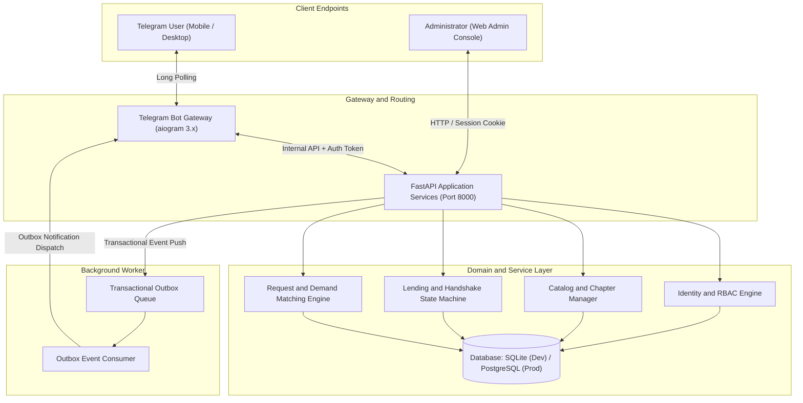

# Boconic - Community Book Circulation and Lending Platform

> Find what you need. Find who can help.
> Version: 2.0.0 | Environment: Python 3.12+ | Production-Ready
> Automated Testing: 66/66 Tests Passing (100% Invariant Verification)

[](https://fastapi.tiangolo.com)
[](https://www.sqlalchemy.org)
[](https://docs.aiogram.dev)
[](https://docs.pydantic.dev)
[](tests/)

---

## 1. Overview

Boconic is an asynchronous, high-concurrency digital platform designed to facilitate textbook circulation, academic material sharing, and community book requests among students, educators, and community libraries.

Key Capabilities:
- Precision Edition Indexing: Tracks educational book editions, curriculum programs, publishers, and specific chapter hierarchies.
- Intelligent Request Matching Engine: Allows users to request whole books or specific target chapters. The system matches and routes notifications to eligible local book owners.
- Dual-Party Lending State Machine: Implements a deterministic handshake protocol for reservations, handovers, and return verifications with timeout protections (72-hour auto-cancellation for inactive reservations) and user trust score weighting.
- Granular Chapter Progress and Fragment Tracking: Mathematical interval union calculations for tracking photocopy fragments and reading progress.
- Dual-Interface Architecture: Complete headless REST API coupled with an aiogram 3.x Telegram bot gateway and a server-side rendered Web Admin Console.

---

## 2. System Architecture



### Technology Stack:
- Web Framework: FastAPI 0.110+, Pydantic v2, Uvicorn ASGI.
- ORM and Storage: SQLAlchemy 2.0 Async (asyncio + greenlet) supporting both SQLite and PostgreSQL 16.
- Database Migrations: Alembic for declarative schema versioning.
- Bot Gateway: aiogram 3.x with MemoryStorage finite state machines (FSM) and inline keyboards.
- Admin Interface: Server-rendered Jinja2 templates, modern responsive CSS, and HttpOnly session protection.
- Reliability Patterns: Transactional Outbox pattern guaranteeing notification delivery across service restarts.

---

## 3. Lending Lifecycle State Machine

The lending lifecycle enforces mathematical consistency through an explicit finite state machine:

```
[Available] 
     |
     v (Borrower requests item)
[Reserved] ---> (72-hour timeout or cancellation) ---> [Available]
     |
     v (Lender confirms physical handover)
  [Active]
     |
     v (Borrower marks return)
[Return Pending]
     |
     v (Lender confirms receipt and inspects condition)
 [Returned]
```

---

## 4. Quick Start Guide

### Prerequisites
- Python 3.11 or higher
- Git

### Linux / macOS Setup
```bash
# Clone the repository
git clone https://github.com/nhdnhut/boconic-book-sharing-platform.git
cd boconic-book-sharing-platform

# Make startup script executable and run
chmod +x start.sh
./start.sh
```

### Windows Setup
```cmd
# Run the automated batch launcher
start.cmd
```

### Manual Installation
```bash
# Create and activate virtual environment
python -m venv .venv
source .venv/bin/activate  # On Windows: .venv\Scripts\activate

# Install dependencies
pip install --upgrade pip
pip install -r requirements.txt

# Run migrations
alembic upgrade head

# Start backend server
uvicorn app.main:app --host 0.0.0.0 --port 8000 --reload
```

---

## 5. Automated Testing

The project includes an exhaustive test suite covering business invariants, state machine transitions, concurrent reservations, and API contracts.

```bash
# Run the entire test suite
pytest tests -v

# Run with coverage report
pytest tests --cov=app --cov-report=term-missing
```

Test Results Summary:
- Total Tests: 66
- Status: 100% Passed
- Invariant Coverage: Complete state transitions, permission gates, interval logic, and matching pipelines.

---

## 6. Directory Structure

```
boconic-book-sharing-platform/
├── app/
│   ├── main.py                 # FastAPI application factory and routing
│   ├── config.py               # Pydantic Settings configuration loader
│   ├── database.py             # SQLAlchemy 2.0 async engine and session factory
│   ├── admin/                  # Web administration routes and templates
│   ├── api/                    # REST API endpoints (v1)
│   ├── bot/                    # Telegram bot handlers and keyboards
│   ├── models/                 # SQLAlchemy ORM declarative models
│   ├── schemas/                # Pydantic request and response schemas
│   └── services/               # Business logic, state machines, and matching
├── migrations/                 # Alembic database migrations
├── tests/                      # Pytest test cases and fixtures
├── compose.yaml                # Docker Compose production configuration
├── Dockerfile                  # Container build specification
├── alembic.ini                 # Alembic configuration
├── pyproject.toml              # Build and dependency configuration
└── README.md                   # Project documentation
```

---

## 7. License and Attribution

This project is licensed under the MIT License. See the [LICENSE](LICENSE) file for full details.

Developed and maintained by Nhut Nguyen (@nhdnhut).

