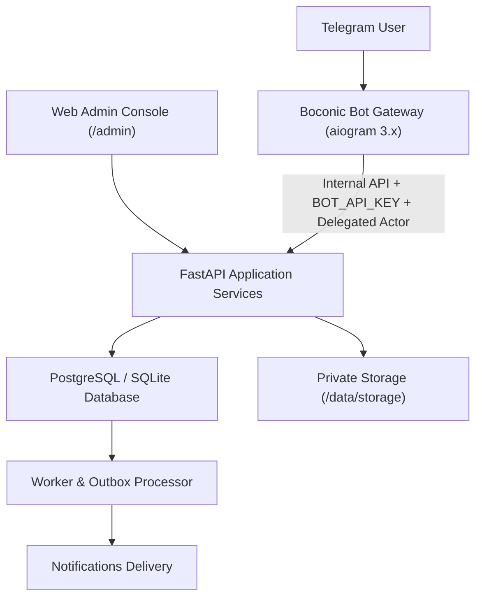

# Boconic — Nền tảng Tiếp cận & Mượn sách Cộng đồng

> **Tagline:** *Find what you need. Find who can help.*  
> **Phiên bản:** 2.0 · Ngày: 01/10/2026 · Ngôn ngữ sản phẩm mặc định: Tiếng Việt.

---

## 1. Giới thiệu dự án

**Boconic** là nền tảng số hỗ trợ cộng đồng (học sinh, sinh viên, phụ huynh, người yêu sách, thư viện và trường học) tiếp cận sách học tập và giáo khoa thông qua cơ chế tìm kiếm chính xác theo phiên bản, kết nối mượn trả hai bên và quản lý tài nguyên số mở tuân thủ nghiêm ngặt bản quyền.

Sản phẩm bao gồm:
1. **Telegram Bot Gateway** (`aiogram 3.x`) dành cho người dùng cuối trên di động.
2. **FastAPI Application Backend** quản lý toàn bộ nghiệp vụ, dữ liệu và bảo mật.
3. **Web Admin Console** (`http://localhost:8000/admin`) hỗ trợ quản trị vận hành hàng ngày (Dashboard, Catalog, Sách vật lý, Lượt mượn, Dynamic Custom Fields, CSV Import/Export, Audit Logs, Backups).
4. **Durable Worker & Outbox** chạy trên PostgreSQL / SQLite xử lý nhắc hạn trả và thông báo nền.

---

## 2. Kiến trúc & Công nghệ



| Thành phần | Công nghệ | Chi tiết |
| :--- | :--- | :--- |
| **Runtime** | Python 3.12+ | Pin phiên bản, không dùng latest |
| **Backend API** | FastAPI + Pydantic v2 | Chuẩn DTO riêng cho Public, Internal và Admin |
| **Bot Gateway** | aiogram 3.x | Long polling chuyên biệt, an toàn không cần public IP |
| **Database & ORM** | PostgreSQL 16 / SQLAlchemy 2.0 (Asyncpg) | Dual-dialect tương thích cả SQLite dev và PostgreSQL prod |
| **Migrations** | Alembic | Quản lý schema database bằng revisions |
| **Admin UI** | Jinja2 + HTMX + CSS Modern | Tối ưu hiển thị, không phụ thuộc CDN bên ngoài |
| **Bảo mật** | PBKDF2 Password Hashing + CSRF | Session server-side, cookie HttpOnly, SameSite=Lax |

---

## 3. Hướng dẫn Cài đặt & Khởi chạy nhanh

### Yêu cầu hệ thống
- Python 3.12 trở lên
- Git
- (Tùy chọn) Docker & Docker Compose

### Bước 1: Chuẩn bị môi trường
```bash
# Clone hoặc mở thư mục repository
cd Boconic

# Cài đặt thư viện dependencies
pip install -e .
```

### Bước 2: Thiết lập cơ sở dữ liệu & Tạo Super Admin
```bash
python scripts/setup.py
```
*Lệnh này sẽ tự động chạy Alembic migrations, tạo cấu trúc bảng, phân quyền RBAC và khởi tạo tài khoản Super Admin mặc định:*
- **Username:** `admin`
- **Mật khẩu:** `Boconic@2026`

### Bước 3: Nạp dữ liệu mẫu tiếng Việt (Demo Dataset)
```bash
python scripts/seed_demo.py
```
*Tạo các đầu sách giáo khoa Lớp 12 chương trình mới (Kết nối tri thức, Chân trời sáng tạo, Cánh Diều) với mã ISBN-13 chuẩn, mục lục các chương, bản sách vật lý mẫu của các người dùng demo và học liệu mở đã kiểm duyệt.*

### Bước 4: Khởi chạy hệ thống

**Chạy API Backend và Admin Web Console:**
```bash
python -m uvicorn app.main:app --host 127.0.0.1 --port 8000
```
Truy cập Admin Console tại: **http://127.0.0.1:8000/admin**

**Chạy Background Worker (xử lý nhắc hạn mượn và outbox):**
```bash
python -m app.jobs.worker
```

**Chạy Telegram Bot Gateway:**
```bash
python -m app.bot.main
```
*(Nếu chưa cấu hình `BOT_TOKEN`, Bot sẽ tự động chạy ở chế độ MOCK/DEMO an toàn mà không làm gián đoạn hệ thống).*

---

## 4. Cấu hình Telegram Bot (@BotFather)

1. Mở ứng dụng Telegram, tìm bot **@BotFather**.
2. Gửi lệnh `/newbot` và làm theo hướng dẫn để đặt tên và username cho bot.
3. Sao chép chuỗi mã Token (ví dụ: `7123456789:AAH...`).
4. Mở tệp `.env` (tạo từ `.env.example` nếu chưa có) và cập nhật:
   ```dotenv
   BOT_TOKEN=7123456789:AAH_your_token_here
   BOT_USERNAME=your_bot_username
   ADMIN_USERNAME=nhutnhd
   ```
5. Khởi động lại `python -m app.bot.main`.

---

## 5. Kiểm thử Tự động (Automated Verification)

Hệ thống đi kèm bộ kiểm thử toàn diện bảo vệ các bất biến nghiệp vụ cốt lõi:

```bash
# Chạy toàn bộ 10 unit & integration tests
python -m pytest tests/ -v

# Chạy kịch bản Smoke Test E2E kiểm tra toàn bộ luồng hoạt động
python scripts/smoke_test.py
```

Các ca kiểm thử chính:
- **Lending State Machine:** Xác nhận giao nhận 2 bên (`lender` & `borrower`), xác nhận hoàn trả 2 bên, ngăn chặn mượn sách của chính mình, chống tranh chấp chỗ (race condition).
- **Custom Fields:** Xác thực 16 kiểu dữ liệu động không cần sửa database DDL.
- **CSV Engine:** Xử lý UTF-8 BOM, kiểm tra định dạng và chống Formula Injection khi xuất bảng tính.
- **Security & RBAC:** Xác thực khóa dịch vụ `BOT_API_KEY` và ngăn chặn giả mạo Telegram ID.

---

## 6. Hướng dẫn Sao lưu & Phục hồi

```bash
# Tạo bản sao lưu toàn diện (Database + Media Manifest)
python scripts/backup.py

# Kiểm tra và diễn tập phục hồi (Restore Rehearsal)
python scripts/restore.py --file data/backups/boconic_backup_YYYYMMDD_HHMMSS.tar.gz
```

---

## 7. Tài liệu chi tiết trong thư mục `docs/`

- [Ma trận Yêu cầu (Requirements Traceability Matrix)](docs/requirements-matrix.md)
- [Bối cảnh Sản phẩm & Quy tắc Tài nguyên số](docs/product.md)
- [Kiến trúc Hệ thống & Ranh giới Tin cậy](docs/architecture.md)
- [Mô hình Dữ liệu (ERD) & Ràng buộc](docs/erd.md)
- [Từ điển Dữ liệu (Data Dictionary)](docs/data-dictionary.md)
- [Máy trạng thái Mượn trả & Giao thức 2 bên](docs/lending-state-machine.md)
- [Kiến trúc Dynamic Custom Fields](docs/custom-fields.md)
- [Đặc tả Nhập/Xuất CSV](docs/csv-specs.md)
- [Luồng Trải nghiệm Telegram Bot](docs/telegram-flows.md)
- [Hướng dẫn Sử dụng Admin Console](docs/admin-guide.md)
- [Đặc tả REST API Contracts](docs/api.md)
- [Sổ tay Vận hành & Sự cố (Runbook)](docs/runbook.md)
- [Quyết định Kỹ thuật (ADR)](docs/decisions.md)
- [Lộ trình Phát triển (Roadmap)](docs/roadmap.md)
- [Báo cáo Bàn giao & Nghiệm thu](docs/handover.md)
